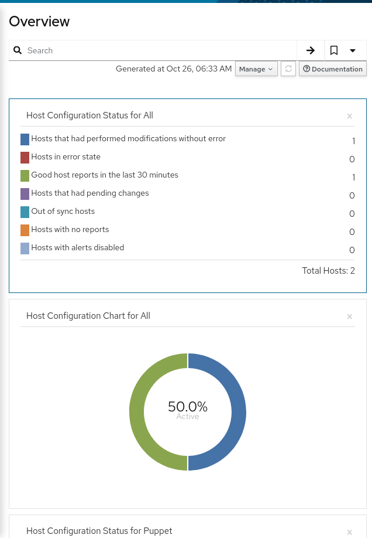
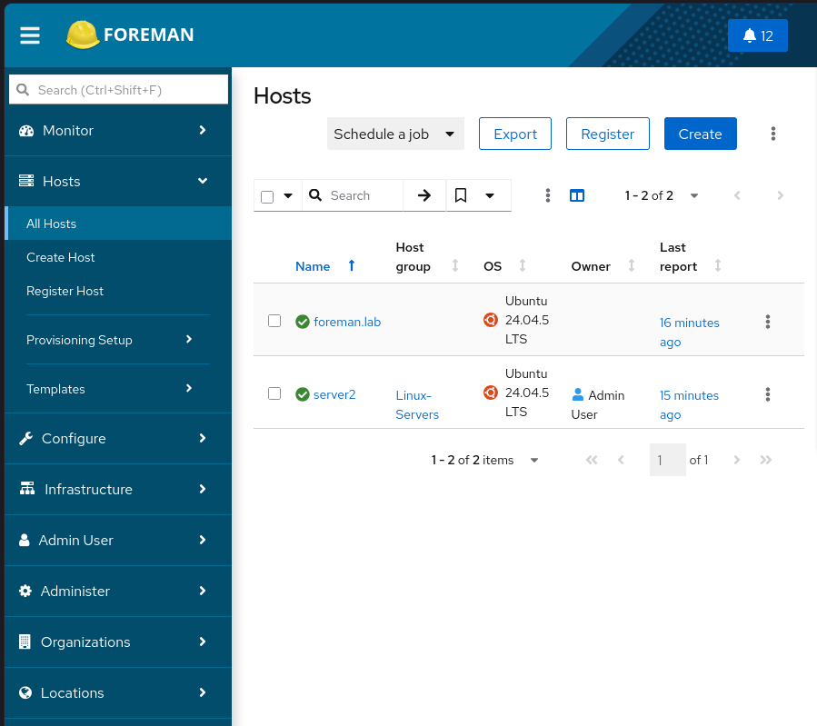
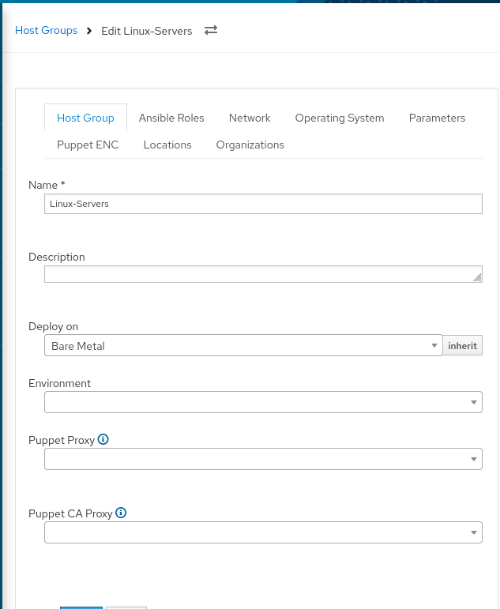
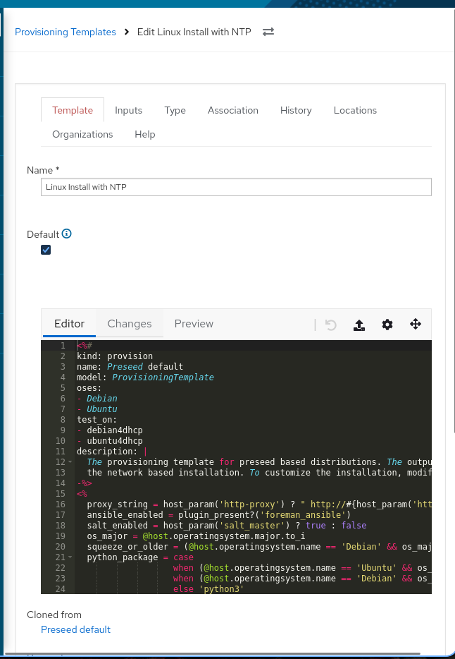
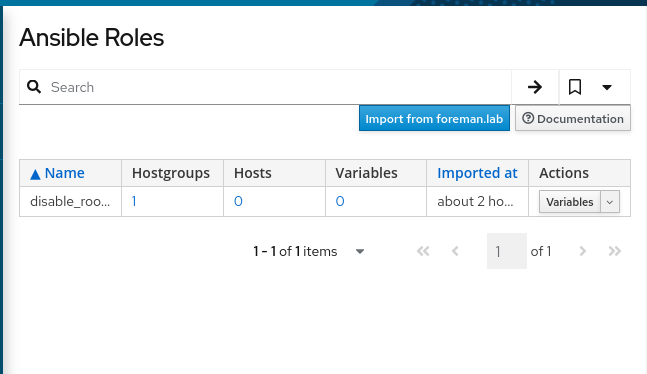
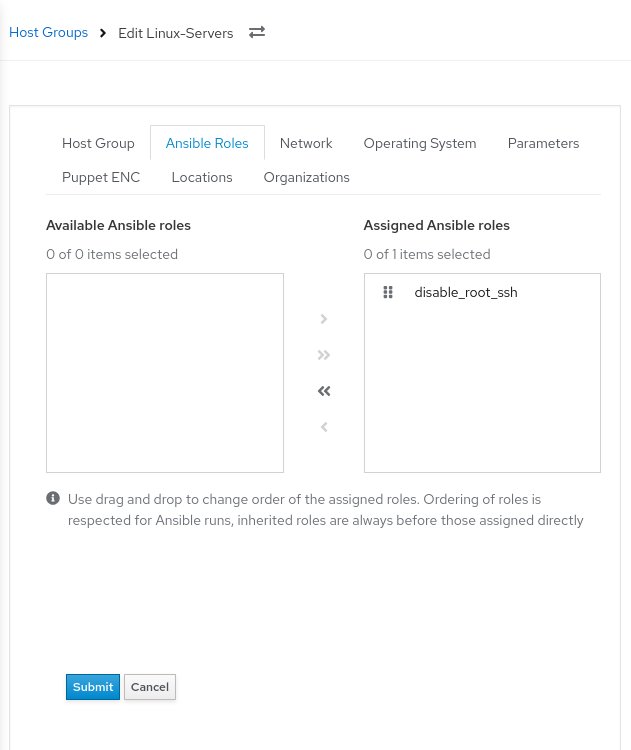
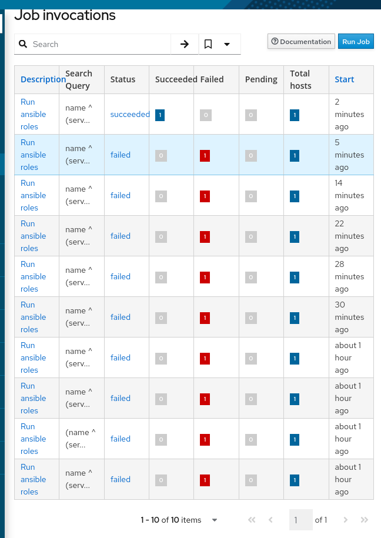
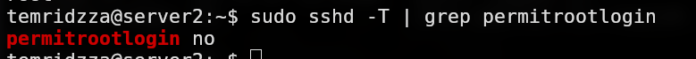

# Тестовое задание: Foreman и Ansible

## 1. Развёртывание Foreman

Foreman развёрнут в виртуальной машине и доступен через веб-интерфейс.

**Скриншот:** главная страница Foreman


------------------------------------------------------------------------

## 2. Регистрация управляемого хоста

В Foreman зарегистрирован хост `server2`, который используется для
проверки конфигурации и выполнения Ansible-роли.

**Скриншот:** страница `Hosts → All Hosts`



------------------------------------------------------------------------

## 3. Host Group и Provisioning Template для настройки NTP

Создана Host Group для назначения общих параметров хостам. Для группы
необходимо назначить Provisioning Template, который выполняет настройку
NTP при установке операционной системы.

**Скриншот 1:** страница Host Group с её настройками.



**Скриншот 2:** Provisioning Template с фрагментом, который настраивает
NTP



------------------------------------------------------------------------

## 4. Интеграция Ansible и применение роли через Host Group

В Foreman настроена интеграция с Ansible. Создана роль `disable_root_ssh`, которая запрещает вход пользователя `root` по SSH, и роль назначена Host Group.

### Задача роли: `tasks/main.yml`

Путь к файлу на сервере, где хранится роль:

```bash
sudo nano /etc/ansible/roles/disable_root_ssh/tasks/main.yml
```

Содержимое:

```yaml
---
- name: Disable SSH login for root
  ansible.builtin.lineinfile:
    path: /etc/ssh/sshd_config
    regexp: '^\s*PermitRootLogin\s+'
    line: 'PermitRootLogin no'
    validate: '/usr/sbin/sshd -t -f %s'
    backup: true
  notify: Restart SSH
```

Задача находит настройку `PermitRootLogin` в `/etc/ssh/sshd_config` и устанавливает значение `PermitRootLogin no`. Перед применением изменений Ansible проверяет конфигурацию командой `sshd -t`, а также создаёт резервную копию файла. Если конфигурация изменилась, запускается handler `Restart SSH`.

### Обработчик: `handlers/main.yml`

Путь к файлу:

```bash
sudo nano /etc/ansible/roles/disable_root_ssh/handlers/main.yml
```

Содержимое:

```yaml
---
- name: Restart SSH
  ansible.builtin.service:
    name: ssh
    state: restarted
```

Handler перезапускает службу `ssh` после изменения конфигурации.

В Foreman настроена интеграция с Ansible. Создана роль
`disable_root_ssh`, которая запрещает вход пользователя `root` по SSH, и
роль назначена Host Group.

**Скриншот 1:** страница роли `disable_root_ssh`



**Скриншот 2:** Host Group с назначенной ролью `disable_root_ssh`.



**Скриншот 3:** успешное выполнение задания Ansible для хоста `server2`
в Foreman.



**Скриншот 4 (дополнительно):** проверка результата на `server2`:

``` bash
sudo sshd -T | grep permitrootlogin
```

Ожидаемый вывод:

``` text
permitrootlogin no
```



------------------------------------------------------------------------

## 5. Сравнение подходов: Foreman и Docker + Nginx + Samba

Foreman и связка Docker + Nginx + Samba решают разные задачи. Docker используется для запуска приложений в контейнерах, Nginx — для обработки HTTP-запросов и работы в качестве обратного прокси, Samba — для организации сетевого доступа к файлам. Foreman предназначен для централизованного управления жизненным циклом серверов, включая установку ОС, регистрацию хостов и автоматизацию их настройки.

### Преимущества Foreman

- Централизованное управление хостами и их параметрами.
- Автоматизация установки и первоначальной настройки ОС с помощью Provisioning Templates.
- Интеграция с Ansible для применения конфигураций к хостам и группам хостов.
- Стандартизация настройки серверов и упрощение повторного развёртывания.
- Возможность масштабирования управления инфраструктурой при увеличении количества серверов.

### Недостатки Foreman

- Более сложная первоначальная установка и настройка.
- Дополнительные требования к ресурсам и обслуживанию управляющего сервера.
- Необходимость разбираться в provisioning, шаблонах и интеграции с Ansible.
- Для небольшой инфраструктуры возможности Foreman могут оказаться избыточными.

### Преимущества Docker + Nginx + Samba

- Возможность собрать решение под конкретные задачи без внедрения отдельной системы управления инфраструктурой.
- Docker упрощает запуск и перенос приложений.
- Nginx позволяет организовать обработку HTTP-запросов и обратное проксирование.
- Samba предоставляет сетевой доступ к файлам.

### Недостатки Docker + Nginx + Samba

- Эта связка сама по себе не обеспечивает полноценное централизованное управление жизненным циклом серверов.
- Автоматизацию установки ОС и настройки хостов необходимо организовывать отдельно.
- При увеличении инфраструктуры могут потребоваться дополнительные инструменты для управления конфигурациями и контроля состояния серверов.

### Вывод

Foreman целесообразно использовать, когда требуется централизованно управлять серверами, стандартизировать их подготовку и автоматизировать применение конфигураций. Docker, Nginx и Samba предназначены для решения отдельных задач и не являются прямыми аналогами Foreman.

Эти подходы могут дополнять друг друга: Foreman может управлять серверами, на которых впоследствии запускаются контейнеры и другие сервисы. Выбор решения зависит от размера инфраструктуры, требований к автоматизации и сложности сопровождения.